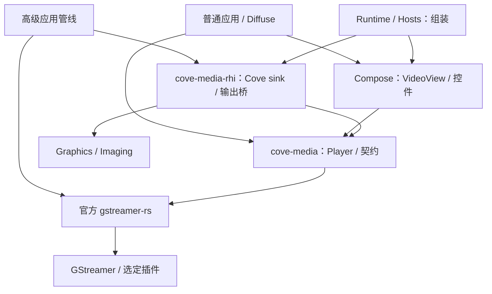

# Cove 音视频：GStreamer 集成设计

日期：2026-11-04。状态：首批原生基础实现已落地；完整 UI、宿主和平台分发仍在实施中。

本文以 GStreamer 为原生媒体引擎，为 Cove 增加可选的播放、视频展示和媒体管线接入能力。`cove-media`、`cove-media-rhi` 和固定源码构建入口已实现，macOS 已验证静态链接、headless 播放与 Metal 上传；媒体构建已收敛为一次 `cargo cove setup --media` 加普通 Cargo 命令（§16.4）。本设计还包含尚未实现的后续能力，不能把全文视为已支持列表；实际范围与证据见 §16.3、§16.4 和 [使用说明](../crates/media/README.md)。本次不发布新版本。

## 1. 设计目标与边界

Cove 是通用框架。音视频设计必须同时服务普通播放器、音频应用、实时输入、后台媒体处理和自定义渲染应用。Diffuse 是验证案例之一，其当前功能和未来需求都不作为 Cove 公共 API 的上限。

本提案采用以下边界：

1. GStreamer 承担媒体管线、格式协商、编解码插件、时钟同步和流事件传播。
2. Cove 提供易用的播放入口，以及媒体管线与 Cove 状态、视图、RHI、宿主生命周期的适配。
3. 高级调用方能够直接使用官方 Rust 绑定和自定义管线，无须等待 Cove 为每种 GStreamer 功能增加包装方法。
4. 默认 UI 应用不因使用 Cove 而自动链接 GStreamer。媒体支持按功能选择。
5. 五个原生平台都要实现基本播放、音频输出和视频展示；平台硬件能力通过实际协商报告。缺少测试设备只影响验收状态，不允许省略平台实现。
6. 浏览器使用独立的媒体后端承接通用播放入口；GStreamer 原生扩展有明确的平台范围。

Diffuse 的项目格式、场景、仿真时钟、剪辑业务、撤销重做和导出策略继续由 Diffuse 持有。Cove 不依赖 Diffuse，也不直接搬入其整个 MediaRuntime。

## 2. 仓库现状与本设计的关系

以下区分已有框架基础与本次新增实现：

| 项目 | 当前事实 | 对媒体设计的约束 |
| --- | --- | --- |
| 工作区 | [Cargo.toml](../Cargo.toml) 已加入可选 GStreamer 绑定及两个媒体 crate | 默认 UI 构建仍不启用媒体依赖 |
| Compose 依赖 | 当前 [Compose manifest](../crates/compose/Cargo.toml) 已依赖 Graphics；[架构文档](architecture.md) 主要保留 Swift 时期分层 | 以 Rust manifest 判断现状；本设计不借媒体接入扩大层间循环依赖 |
| 图像持有 | [TextureImage](../crates/imaging/src/texture_image.rs) 用 backing 保留资源，[TextureResource](../crates/graphics/src/rhi/resource_ownership.rs) 保留设备并延迟释放纹理 | 视频发布应沿用快照持有资源的语义 |
| UI 纹理入口 | [texture_image](../crates/graphics/src/ui/texture_image.rs) 当前接受可采样的 RGBA8/BGRA8 二维纹理 | 不能把 YUV、P010 或 HDR 帧直接标记为已有 UI 图像 |
| RHI | [公开 RHI 模块](../crates/graphics/src/rhi/mod.rs) 已有设备、提交和退休机制；本次未找到受支持的完整媒体外部表面导入契约 | 外部内存导入、同步与释放协议是待设计和实现的工作，不能把裸指针强转为 RHI 句柄 |
| 原生构建 | [cove-native-build](../crates/native-build/src/media_provider.rs) 在 sys crate 构建脚本内完成固定源码构建、静态链接与 pkg-config 隔离；[setup](../crates/native-build/src/setup.rs) 负责工具与平台 SDK 检查安装 | 日常入口是普通 Cargo 命令；其他平台完整构建仍待验收 |

当前已实现原生播放器、appsink 视频端点、平台音频 sink 选择和 CPU→RHI 上传。GPU 共享导入、VideoView、Browser 与宿主音频会话/焦点策略尚未完成；下文相关条目仍是实施要求。

## 3. 为什么采用 GStreamer

GStreamer 已提供 [格式协商][gst-caps]、[时钟同步][gst-clocks]、[应用输入输出][gst-app] 和插件机制。官方项目维护 [gstreamer-rs][gst-rust]，可用于应用及插件开发。这使 Cove 可以把工作集中在框架集成和平台适配。

普通播放优先使用 [playbin3][gst-playbin3] 构建会话：它能够进行流选择，并允许指定音视频 sink。当前 [GstPlay 文档][gst-play] 标记其 API 为不稳定，本提案不把它作为 Cove 公共 API 的组成部分；后续若内部采用，必须固定版本并验证行为。

FFmpeg 可以通过 [gst-libav][gst-libav] 提供编解码能力。采用 GStreamer 不等于完全移除 FFmpeg，也不要求所有构建包含 FFmpeg。具体包含哪些编解码器由产品的插件清单决定。

[GStreamer Editing Services][gst-ges] 可作为编辑应用的可选能力，单独评估。Cove 的普通播放模块不依赖 GES，Diffuse 的业务时间线也不自动替换为 GES。

## 4. 模块划分与依赖方向

物理边界如下；UI/宿主/Browser 条目仍待实现。

| 所有者 | 公开范围 | 依赖与职责 |
| --- | --- | --- |
| 新增 cove-media | MediaContext、Player、状态、命令结果、输出端点与能力查询 | 无窗口播放控制和 GStreamer 会话；不依赖 Compose、Runtime、Graphics 或 Diffuse |
| cove-media 的 gst 扩展 | 官方绑定再导出、GStreamer 管线/输出端点接入 | 原生高级入口；复用 gst::Pipeline、gst::Element、gst::Sample 等原生 Rust 类型 |
| 新增 cove-media-rhi | Cove 视频 sink、帧发布、RHI 导入/转换与诊断 | 依赖 media、graphics、imaging；负责设备与 GPU 生命周期 |
| cove-ui-compose 的可选 media 模块 | VideoView、可选播放控件 | 依赖 media 的控制与展示契约；通过宿主注入的服务取得输出 |
| Runtime/Hosts 的媒体适配 | 服务安装、状态派发、应用前后台、设备和音频会话生命周期 | 组装上述模块；不让 media 反向依赖宿主 |
| Browser 的媒体适配 | 通用播放与视图接口的浏览器实现 | 采用浏览器媒体能力；不链接原生 GStreamer |

下图描述原生路径，箭头表示“依赖/使用”，不是数据流方向。

cove-ui 的媒体功能必须显式启用；基础控件、文本和布局构建不带入该依赖闭包。headless 媒体操作可以只使用 cove-media，原生管线用户也可以直接依赖官方绑定。

不为每个播放器、每种格式或每个插件单独创建 crate。cove-media-rhi 的单独边界用于避免媒体控制依赖 GPU，并隔离平台资源适配。

VideoOutput 在 media 中声明中立的端点与发布/订阅契约；具体的 Cove sink 工厂、RHI 帧租约与展示适配在 cove-media-rhi 中实现，UI 经宿主安装的服务取得展示快照。media 不反向导入该适配 crate，也不为了声明输出接口而链接图像解码器。Browser 实现同一高层控制/输出契约，其目标依赖中不包含原生 GStreamer；上图的 Media→GST 边只适用于原生构建。

## 5. 公共接口：常规播放与高级接入

### 5.1 常规播放

以下定义接口职责；原生控制与输出接口已实现，VideoView/PlaybackControls 仍为后续交付。可编译用法见 crate README 和 `headless` 示例。

| 入口 | 操作/结果 | 契约 |
| --- | --- | --- |
| MediaContext | 创建 Player、查询部署能力、取得诊断信息 | 持有共享控制线程和配置；不是独立的 GStreamer 进程或插件注册表 |
| Player | open、play、pause、seek、select_tracks、set_rate、set_volume、close | 提交命令并返回 RequestId；耗时结果通过事件确认 |
| PlayerSnapshot | 播放意图、实际状态、缓冲、位置、时长、轨道、最近错误 | 不把正在缓冲等同于用户暂停；未知值保留为未知 |
| PlayerEvent | 状态/轨道/格式变化、命令完成、EOS、错误、关闭完成 | 含 player/source generation、事件序号和关联请求；错误不伪装成 EOS |
| VideoOutput | 提供可订阅的展示端点 | 可与 Player 绑定，也可由高级管线驱动 |
| VideoView | 订阅 VideoOutput，配置缩放与裁剪 | 不因视图重建而重新打开媒体或创建解码器 |
| PlaybackControls | 绑定 Player 的控制和可访问性状态 | 与画面展示分离，可用于纯音频 |

play/pause 等命令“被接受”与“已生效”是不同结果。打开失败、取消、被后续请求替代和实际完成必须分别可观察，不能仅以 Result<()> 表示整个异步生命周期。

Player 是共享的控制句柄，订阅者取得不可变快照。视图挂载不自动取得播放器的停机所有权；显式配置的 autoplay、不可见时暂停、静音等策略才改变播放行为。

### 5.2 高级 GStreamer 接入

高级用户直接使用官方绑定描述管线，Cove 只提供接入所必需的端点：

- CoveVideoSink：接收 GstBuffer/GstSample 及格式/segment 事件的 sink 或 sink bin；与一个 VideoOutput 关联。
- GstVideoEndpoint：暴露可加入调用方管线的 gst::Element，以及独立的展示输出与诊断接口。它不隐式拥有调用方的整个 pipeline。
- gst 扩展模块：受版本约束地再导出同一套官方绑定，降低应用误混不同版本类型的概率。
- 对自有媒体源、帧处理与编码，调用方可以使用 [appsrc/appsink][gst-app] 或自行实现 GStreamer element，不需要 Cove 增加相同功能的代理方法。

只接入视频 sink 不意味着 Cove 可以控制任意自定义管线。需要播放控件时，应用实现一个窄的 PlaybackController 适配器，提供状态、受支持的控制操作与命令结果。Cove 不推断任意管线的时长、寻址性或轨道结构。

高级入口明确暴露 GStreamer 依赖；通用 Player/VideoView 接口不包含 Gst 类型。这里保留两种清晰的使用方式，不再包装一套等价的 Element、Pad、Caps 或 Pipeline 对象体系。

### 5.3 配置与版本演进

通用配置保持类型明确，使用 builder 和可演进的公开枚举/结构；不把任意字符串字典作为能力契约。后端专属选项位于 gst 扩展中，应用可以直接配置所选 element。

增加新能力优先增加独立模块、输出适配器或可选接口，不给第三方实现的公共 trait 任意新增必需方法。绑定版本由同一 Cargo 依赖闭包统一；源码层的再导出不承诺不同 gstreamer-rs 版本或外部插件的二进制 ABI 可混用。

## 6. 来源、能力与格式协商

通用来源应覆盖本地路径/文件、URI、内存内容和应用提供的数据流。可读、可寻址、可取消、已知长度等是独立能力；直播不能用伪造的无限文件长度表示。

URI 来源有两种明确的接入路线：

1. 使用构建中选定的 GStreamer source 插件处理协议。
2. 应用需要统一认证、缓存或访问策略时，通过已有 cove-http/应用 I/O 加 appsrc 接入。

同一来源只由一条路线读取，避免双重下载、重复缓存和不一致的取消。应用数据源不得假装可 seek；字节 seek 与媒体时间 seek 也不能混为同一操作。

能力必须区分四个层次：

| 层次 | 示例 | 用途 |
| --- | --- | --- |
| 部署能力 | 包内包含哪些 source、demuxer、decoder、sink | 排查插件是否存在 |
| 当前媒体能力 | 实际轨道、可寻址范围、时长是否已知 | 驱动控件和操作校验 |
| 请求偏好/约束 | 优先硬解、必须硬解、输出内存/格式要求 | 决定是否允许回退 |
| 已协商结果 | 实际 decoder、像素格式、内存类型、采样率 | 向调用方和诊断明确报告事实 |

管线重新协商后发布 FormatChanged；不能认为第一个分辨率、轨道集合或声道布局在整个播放期间保持不变。

硬件解码与 GPU 零拷贝分开报告。能硬解不表示结果能被 Cove RHI 直接采样；必须硬解的请求也不能被静默的软件回退满足。

## 7. 时间、播放状态与寻址

原生适配内部保留 GStreamer 的 buffer 时间戳、segment 和 clock 语义，[媒体位置和运行时间有不同用途][gst-clocks]。Cove 的通用时间类型可使用整数纳秒，并显式表达未知值；高级入口保留完整 Gst 数据。

应用帧号、帧率和工程有理数时间基由应用持有。换算为纳秒时需要约定舍入、溢出和误差；不能把纳秒位置反推为固定帧率，也不能承诺任意源都能无损表示所有有理数时刻。

PlayerSnapshot 至少将以下信息分开：

- requested_state：用户希望播放、暂停或停止。
- pipeline_state：底层实际状态与尚未完成的转换。
- buffering/seeking：当前等待原因。
- position/duration/seekable_range：已知值或未知，不以 0 代替未知。
- selected_tracks 与 negotiated_formats：当前实际结果。

seek 接口区分关键帧/快速寻址与精确寻址，返回实际到达的时间及完成状态。[GStreamer 寻址是事件驱动的过程][gst-seek]；调用返回不表示目标画面已经可展示。

每个打开/关闭周期有 source generation，每个 seek 有 RequestId。交互播放可采用“最新 seek 优先”，离线批量任务采用显式的顺序处理策略。所有被接受的请求最终都要有 completed、failed、cancelled 或 superseded 结果。

适配器必须关联 flush、segment、事件序号与请求生命周期，拒绝旧 generation 的画面和完成事件。不能把下一个 ASYNC_DONE 无条件归给最近一次 seek；准确关联方案须通过连续 seek、切源和取消的技术验证。

实时展示由媒体时钟决定帧何时到期，Cove 显示刷新负责绘制已到期画面。不能在 GStreamer sink 和 UI 中重复施加不一致的播放等待。离线消费可以关闭实时等待，保持顺序并通过背压限制生产速度。

## 8. 线程、消息与关闭

原生默认采用每个 MediaContext 一个媒体控制线程，管理自己的 GLib MainContext 和总线消息派发；GStreamer 自行管理媒体流线程。具体 GLib Source 必须附着到指定上下文，不能误用要求默认 main loop 的 watch。总线也支持同步/轮询接入，见 [Rust Bus 文档][gst-bus]。

| 执行位置 | 允许的工作 | 约束 |
| --- | --- | --- |
| Cove UI 线程 | 发送控制命令、消费快照、更新视图 | 不等待 seek、解码、GPU 完成或网络 I/O |
| 媒体控制线程 | 管线状态变更、bus、取消与命令结果 | 通过 std 通道或 GLib source 接收命令，不引入 Tokio |
| streaming 回调 | 取得样本、引用计数保留、写入有界队列、发唤醒 | 不直接操作视图，不持有锁调用 UI，不进行 RHI frame 操作 |
| RHI 所有者线程 | 导入/转换、记录命令、提交、退休资源 | 遵循现有设备的 frame session 和资源状态规则 |
| GPU 完成路径 | 发出完成事实、安排资源退休 | 不在未知线程上直接调用有线程要求的媒体释放 API |

样本队列按帧数、字节数和必要的时长限制配置。实时展示可以丢弃过期帧；离线处理默认阻塞生产者，不能套用播放器的丢帧策略。[appsink][gst-appsink] 和 [appsrc][gst-appsrc] 的队列行为必须在固定版本上显式配置，不能依赖无界默认值。

控制命令和完成事件与帧队列分开。命令队列满时，提交端非阻塞地返回 Busy/未接受结果；已接受的命令不能无声丢失。位置/缓冲快照可以合并更新，命令结果、错误和关闭完成必须保留到被消费或显式取消订阅。慢订阅者需要有界缓存和可查询的请求终态，不能通过无限堆积事件实现可靠性。

close 的顺序是：拒绝新命令、取消生产、停止管线、解除回调/watch、使展示订阅失效、安排在途资源退休，最后发 Closed。控制面的 Closed 不表示应用保留的帧租约已被强制释放。

Drop 发起不阻塞 UI 的关闭；等待关闭由显式的等待入口或测试/宿主停机路径承担。禁止在 streaming 回调中 join 自己或等待持有其资源的 GPU 工作。状态锁外派发用户回调，订阅使用弱引用或显式取消，避免 Player、pipeline、sink 和视图形成引用环。

GStreamer 的初始化与插件注册是进程级状态。MediaContext 之间不具有插件、安全或全局配置隔离；单个播放器关闭不能调用全局 deinit，也不能为选择解码器而随意修改全局插件 rank。

## 9. 帧、音频与资源所有权

高级接口直接使用 gst::Sample、gst::Buffer、视频/音频格式描述和受生命周期约束的映射视图。常规播放入口只暴露应用控制和展示所需的信息，不重复定义整个 Gst 元数据系统。

处理帧时必须保留：PTS、可选时长、格式、有效尺寸、每平面布局/stride、色彩矩阵、range、transfer、primaries、方向、像素宽高比及必要的 HDR 元数据。缺少信息时标为未知，不能默认所有帧都是同一种 SDR 色彩空间。

CPU map 的视图只在映射对象及其 backing 存活时有效。硬件内存的映射可能失败或产生下载，调用方必须显式请求；不能因为提供了 read 方法就宣称其无拷贝。

音频保留实际 sample format、采样率、声道布局和平面布局。48 kHz、双声道、interleaved f32 只是一种可请求的转换目标。

一个发布帧由租约持有底层 sample、必要的设备引用与导入资源；UI 快照继续持有该租约。解码器停止、播放器关闭、尺寸变化或新帧发布，都不能让旧快照里的资源立即失效。GStreamer 的 memory/buffer pool 行为见 [内存分配文档][gst-allocation]；实际回收必须同时满足媒体引用释放与 Cove GPU 消费完成。

设备恢复或管线重建后，新资源使用新的 device/source generation。旧图像可以退出展示，但不能被重新解释为新设备资源。

## 10. GStreamer 与 RHI 的接入

### 10.1 四种传输路径

| 路径 | 工作方式 | 诊断要求 |
| --- | --- | --- |
| 原生共享导入 | RHI 采样兼容的外部表面/平面，保留生产者资源 | 报告实际共享内存、设备及同步协议 |
| GPU 内复制/转换 | 复制或转换到 Cove 自有纹理 | 报告 GPU copy/convert；不能标记为零拷贝 |
| CPU 映射与上传 | 映射/下载、必要转换、上传到 RHI | 报告 CPU copy、download、upload 和字节数 |
| 明确拒绝 | 请求必须满足的内存或格式条件不可实现 | 返回可解释错误，不静默违反要求 |

“无 CPU 回读”和“没有任何复制”是不同指标。是否零拷贝必须由实际内存、传输和同步路径证明，不能仅根据解码插件名称推断。

实现顺序允许先完成正确的 CPU 上传路径，再实现硬件优化；发布时必须列出每个平台实际执行的路径和成本。

### 10.2 需要新增的通用 RHI 契约

新增外部资源入口应由 Graphics 定义，媒体桥调用。它的契约至少描述：

- 原生设备身份与兼容条件，禁止把不同设备/adapter 的对象直接混用。
- 外部资源类型、格式、每平面视图、尺寸、usage 和允许的操作。
- 借用/转移/复制的所有权模式，以及释放回调应在哪个线程执行。
- producer 完成的等待、consumer 完成的通知、资源状态/layout、queue ownership。
- 帧池复用的时点和提交失败、取消、设备丢失时的回收规则。
- 能力查询，以及失败后可选择的显式复制/上传路线。

外部句柄导入属于窄的、可审计的平台边界；安全封装验证设备与生命周期。禁止从原生地址构造普通 Texture ID，也禁止把 Arc 引用计数当作跨 GPU 队列同步。

在上述契约通过设备测试前，不能宣称现有 TextureResource 已经能直接包装所有 GStreamer 硬件帧。

### 10.3 与 Cove 视图和色彩管线的关系

VideoView 的输出需要参与 Cove 的布局、裁剪、透明度、变换、遮罩、快照和可访问性。默认不依赖媒体插件创建独立窗口覆盖在 Cove 窗口上。

最小实现可以将视频转换为当前 UI 接受的 RGBA/BGRA 纹理，再通过 TextureImage 持有。保留 YUV、多平面和 HDR 的路径需要视频材质/绘制入口或明确的 GPU 色彩转换步骤；不能仅凭类型擦除 backing 让现有图片 shader 自动理解新格式。

色彩转换、tone mapping 与输出显示空间要有单一明确的所有者。媒体端已经转换到目标空间时，UI 不重复转换。透明视频、方向、像素宽高比和动态分辨率都是展示验收项。

## 11. 音频输出与宿主生命周期

默认播放器可选用部署清单中支持的平台音频 sink，时钟同步由 GStreamer 管线维护。普通媒体播放不必先依赖一个尚未落地的 Cove SDL 音频 API。

需要与应用自己的混音器或设备共用输出时，另做音频 sink/输出适配器，明确采样位置、设备时钟、重采样、欠载和背压。应用不能同时让 GStreamer 默认 sink 和自有输出各播放一次。

Hosts 负责把前后台、音频焦点/中断、设备切换、耳机插拔、窗口销毁、权限和允许的后台播放策略传给媒体服务。暂停渲染不必然等于暂停音频，具体行为由应用策略决定。

纯音频 Player 不产生视频帧或创建 RHI 设备；playbin 的视频 sink 配置保留一个轻量 appsink，避免后端自动创建独立视频窗口。无 GPU 的后台转换不初始化窗口系统。

## 12. 平台实现与验证矩阵

五个平台共用已实现的控制、帧持有和 RHI 上传代码，并有明确的平台音频/插件配方；macOS 已执行基础测试，其他平台尚未编译和实机验收。Browser 属于 P4，尚未实现。下表仍列出完整验收要求，不能作为全部通过的声明。

| 平台 | 基本实现与输出要求 | GPU 候选路线及需验证条件 | 平台验收 |
| --- | --- | --- | --- |
| macOS | 软件/平台解码、音频、Metal 上传展示 | VideoToolbox 产生的 CVPixelBuffer/IOSurface 与 Metal 平面纹理候选；须先验证固定版本插件的真实内存、可提取性及同步 | 实机播放、seek、resize、多窗口、设备与快照生命周期 |
| iOS | 原生静态插件注册、音频会话、Metal 展示；真机/模拟器分别构建 | 同属 Apple 平台不等于与 macOS 内存路径相同；逐项验证所选插件和可共享表面 | 真机硬解、前后台/中断、内存压力、签名和包内插件 |
| Windows | 软件/平台解码、音频、D3D12 展示，适配可用的 Vulkan 后端 | D3D11/D3D12 解码纹理与 Cove 实际设备的共享或复制；核对 adapter、共享句柄与 fence | MSVC clean build、插件加载、GPU 同步、DPI/resize、设备丢失 |
| Linux | 软件/平台解码、音频、Vulkan 展示 | 所选插件的 VulkanImage/DMABuf 等内存与格式/modifier/layout/queue 条件；不把 GL 路径当作 Vulkan 路径 | X11/Wayland、音频设备、不同驱动、打包后无开发环境运行 |
| Android | JNI/插件初始化、音频焦点、Vulkan 展示与 surface 重建 | MediaCodec 输出模式的实际内存；Surface/GL 输出不能自动视为 AHardwareBuffer/Vulkan 可导入结果 | 每个受支持 ABI、真机硬解、旋转、前后台、权限、APK 内插件 |
| Browser | 通用 Player/VideoView 的浏览器媒体后端，随 Browser 能力单独落地 | HTMLMediaElement；帧处理/纹理互操作按 WebCodecs 等可用能力另行验证 | 自动播放规则、CORS、后台暂停、媒体/图形设备能力；原生 gst 扩展不作为浏览器承诺 |

已核对的上游资料包括 [Apple vtdec][gst-vtdec]、[D3D12 解码内存示例][gst-d3d12]、[VulkanImageMemory][gst-vulkan] 和 [硬件解码说明][gst-hardware]。Apple 文档中的 GLMemory、Android 的 GL/Surface 路线和上述 Metal/Vulkan 候选之间仍有适配工作，不能推导为现成的零拷贝桥。

Browser 不作为跳过五个平台原生实现的理由，也不把不适用的原生扩展用空实现伪装成可用接口。

## 13. 构建、依赖与插件分发

### 13.1 依赖计划

已固定官方 gstreamer/gstreamer-video/gstreamer-audio 0.25.4、gstreamer-app 0.25.2，启用 `v1_28`；glib 由 Cargo.lock 固定。原生 GStreamer 为 1.28.8，子模块 revision `1b2a95a1b72787cda146b46df9605b168e5b683b`，其 wraps 提供传递源码版本及哈希。完整平台构建与分发验收仍未完成。

Rust 绑定和原生 GStreamer 是两部分依赖。只加入 Cargo crate 不会自动解决原生库、插件、平台工具链和发布包的构建。

现有 Cove 约定为固定源码、构建到 OUT_DIR 和静态链接。[上游使用 Meson][gst-meson]，[Cerbero][gst-cerbero] 提供跨平台依赖和打包配方。本设计要求实施批次明确扩展 cove-native-build：

- 固定源码 revision/哈希、补丁、工具版本、Meson 选项和所有选中插件的依赖闭包。
- 明确 host 工具与 target 库的构建区分；pkg-config 只解析当前 target 的产物，不能误链接开发机系统库。
- 证明 Rust sys crate 的发现/链接顺序与源码构建协调可行，避免构建循环和多份原生库。
- 禁止 Meson auto-detect 使开发机安装的软件改变发布能力；显式选择插件并验证输出清单。
- 构建输出位于按构建身份指纹分区的用户缓存（`COVE_CACHE_DIR` 可重定向）；依赖下载与源码准备遵循固定来源，子模块未初始化时按固定 revision 获取。
- 使用 Cerbero 时明确它与 Cargo 产物布局的衔接。上游 bootstrap 可能修改宿主环境，不能在普通 build.rs 中直接运行未经约束的安装流程；工具与 SDK 的安装只发生在显式的 `cargo cove setup` 入口，构建脚本只发现和使用已验证的工具。

能否完整沿用源码静态构建，是进入正式实现前的验证门禁。若确需改变 Cove 的原生分发规则，必须单独记录架构决策，不以文档示例或本机 SDK 路径暗中替换。

原生构建已并入 Cargo 依赖链，不再是两步流程。官方绑定固定版本的源码副本随仓库保存在 `third-party/rust-media/`，其 `*-sys` 构建脚本先调用 `cove-native-build`：按 `target`/`host` 与工具、编译器、SDK、Meson 选项构成的身份指纹在用户缓存中定位原生树，缺失时自行完成源码准备（子模块未初始化时按固定 revision 获取）、Meson 构建、静态链接安装和许可证收集，再以该树的 pkg-config 目录重新执行自身探测。进程锁避免多个 sys crate 重复编译；指纹变化才重建，`rerun-if-env-changed` 覆盖工具链与 SDK 变量。因此 `cargo build`、`cargo test`、`cargo run` 加上 `gst` feature 就是完整入口，下游应用不需要 `[patch]`、额外构建脚本、pkg-config 配置或 SDK 环境变量。工具检查与安装由 `cargo cove setup --media` 承担（见 [crate README](../crates/media/README.md)）。构建清单包含 revision、target、工具/编译器与 Meson 选项，清单指纹进入 pkg-config 路径以触发 Cargo 正确重建。没有改变静态源码分发方向；显式 `COVE_MEDIA_NATIVE_PREFIX` 只保留给 LGPL 重新链接。当前已证明 macOS 的宿主构建与仓库外独立应用路线，其他平台的门禁仍开放。

### 13.2 功能闭包

| 拟议功能集合 | 内容 | 分发要求 |
| --- | --- | --- |
| 基础媒体 | core、应用输入输出、格式处理与测试源 | 可无窗口运行；明确列出实际格式支持 |
| 播放 | playbin3、所选容器/解码器、转换与平台音频 sink | 包内完整，不依赖用户另装开发 SDK |
| 网络来源 | 选定协议插件或应用 source 适配 | 独立启用，认证/取消/网络访问有明确所有者 |
| 硬件适配 | 按平台选择解码与内存插件 | 能力按运行时设备协商，包含显式回退策略 |
| 编码/封装 | 选定 encoder、muxer 与可选 gst-libav | 与普通播放解耦；应用可提交自定义渲染帧 |
| 编辑服务 | 可选 GES | 不进入基础 Player/VideoView 依赖闭包 |

上表定义依赖闭包，不把运行时 profile 当作 Cargo 可卸载模块。Cargo feature 会在依赖图中合并；多个应用库请求不同能力时，最终包的插件集合是合并后的构建结果。

### 13.3 插件发现与隔离

静态插件需要显式注册并测试链接器裁剪后的可发现性，见 [静态插件说明][gst-static]。动态插件方案若被采用，必须记录随包路径、依赖和 scanner；不能靠构建机的 GST_PLUGIN_PATH 才能运行。

registry、环境与初始化采用进程级、可重复的设置。应用启动后不逐播放器改全局环境；发布包不得意外扫描并加载系统中另一版本的插件。受控部署仍不能被解释为恶意插件的安全沙箱。

当前固定源码 profile 以 `gstreamer:registry=false` 关闭文件注册表扫描，保留内存注册表和 `gst-full` 静态注册；应用在构建器之外启动也不会自动扫描本机 SDK。自定义 Rust 插件仍可显式静态注册。需要动态插件的应用须采用明确的其他构建 profile，不能把本批默认闭包描述成动态插件加载器。

记录每个插件及其外部库的许可证、构建配置、源码和通知要求；按实际分发闭包进行发布审查。插件所在的 base/good/bad/ugly 分组不能代替逐项判断，参见 [官方许可说明][gst-license]。本设计不预先断言任意静态链接组合都可直接发布。

现有固定源码构建自动生成 `<prefix>/share/licenses/cove-media/`：包含原文、逐组件清单、Cargo 锁定信息、Meson 项目/目标/依赖记录和 wraps/补丁。收集规则与原文在 `LICENSES/media/`，缺失声明会令构建报错。静态 LGPL 对应源码和应用重新链接材料须另外随版本提供，具体操作见 [媒体许可证与分发](media-licensing.md)。

## 14. 错误与诊断

普通调用者得到类型明确的错误类别：初始化/插件缺失、来源/I/O、格式/解码、协商失败、不支持的操作、GPU 互操作、设备丢失、取消与关闭。高级诊断保留底层错误域、code、element 名和 debug 信息。

每次会话记录：构建版本、实际插件与 decoder、已协商 caps/内存、当前时钟、队列深度、丢帧与原因、seek 时延、传输路径及拷贝字节数。统计区分生产、队列丢弃、提交与实际展示；没有设备时间戳时不把 CPU 时长标为 GPU 耗时。

日志走 cove-logging；帧事件避免逐帧刷日志。诊断导出需清理来源 URI 中的认证信息与应用私有内容。

DevTools 可展示 Player 状态和媒体输出节点；实际交互/视觉验收沿用 [DevTools 工作流](../crates/devtools/README.md)。本次文档不注册未实现的 Website 组件或宣称 Gallery 已具备播放页面。

## 15. Diffuse 与其他应用的接入

用以下三条独立路径检验通用性：

1. 普通播放器使用 Player + VideoView，验证控制、音视频同步、轨道选择和 UI 生命周期。
2. headless 工具通过 appsink 取得样本、生成缩略图或分析音频，不创建 UI/RHI。
3. Diffuse 使用自定义管线取得媒体帧，接入自己的场景/时间线；导出时通过 appsrc 或自定义 element 提交带时间戳的帧，再编码封装。

Diffuse 的导出分辨率、帧率、有理数时间基、音频混音、颜色管理和帧完整性由其业务明确指定。Cove 只提供管线与资源互操作，不替应用选择离线丢帧、循环、重采样或 tone mapping 策略。

迁移分批进行：先接回现有解码与寻址，再验证音频/视频播放，再接离线编码。每批用现有真实夹具比较结果；GStreamer 已能播放不等于替代实现满足原导出、采样边界或文件格式契约。

旧 FFmpeg 桥只在替代路径完成行为验证后移除；过渡阶段明确每种操作实际使用哪条路径。最终构建应排查是否仍有多份 FFmpeg/原生媒体依赖，不能无意重复打包。

本设计不要求 Cove 读取 Diffuse 的工程文件，也不把 Diffuse 的资产 URL、组件类型或项目 schema 放入框架接口。

## 16. 分阶段实施与门禁

阶段划分保持如下；本批实现与验证见 §16.3。每阶段完成后更新证据，不将“可以编译”写成“设备行为通过”。

| 阶段 | 交付 | 进入下一阶段的证据 |
| --- | --- | --- |
| P0：构建与互操作验证 | 固定候选版本、源码构建方案、五平台工作清单；可运行的 headless 管线与 RHI 小样 | 无全局 SDK 的构建证明；各平台软件路径实现；GPU 导入/复制/上传的实测或明确失败记录；确认关键阻塞的处理方案 |
| P1：媒体控制与高级端点 | MediaContext、Player、bus/线程、请求结果、appsrc/appsink 接入 | 状态、EOS、取消、seek、队列与关闭测试；不反向依赖 UI |
| P2：Cove 视频展示 | sink、帧租约、CPU 上传基线、全部原生平台音频与显示接线 | 裁剪/变换/resize/旧快照保留，连续运行资源有界；平台实现完整 |
| P3：设备优化 | 可用平台的共享导入、GPU 转换、时钟/设备恢复和诊断 | 每条硬件路径的设备与同步证据；硬解/传输/颜色结果准确报告 |
| P4：UI 与宿主 | VideoView、控件、可访问性、Browser 后端和宿主策略 | Gallery 页面、Website Rust 文档与导航；原生交互/视觉及浏览器单独验收 |
| P5：应用迁移与发布 | Diffuse 与独立 headless 示例、插件分发及版本文档 | 应用回归、干净机器运行、完整依赖/插件清单、CHANGELOG 与平台限制说明 |

### 16.1 必需回归

- 纯音频、纯视频、音视频、多轨道、字幕、未知时长与不可 seek 来源。
- open 失败、EOS、损坏输入、缺插件、网络取消、关闭中回调和重复关闭。
- 连续 seek、seek 后切源、旧帧迟到、可变帧率、关键帧与精确寻址结果。
- 实时队列满时的丢帧，以及离线队列满时的背压；超时、错误、EOF 分别断言。
- 格式/分辨率/声道变化、逐平面 stride、方向、range、色彩转换和支持范围内的 HDR。
- CPU/GPU 帧映射、跨线程释放、设备不匹配、提交失败与内存池复用。
- resize、暂停/关闭后保留旧视图快照，以及播放器和 RHI 设备的不同析构顺序。
- 多播放器、多窗口和多 MediaContext 的全局注册冲突、资源占用与停机。
- 至少一个独立 headless 消费者与一个应用自定义管线，防止 API 只适配示例播放器。

测试夹具尽量选择可再分发的已知内容，记录音视频时间戳、样本数量、像素/音频比较容差和允许的编码差异。有损编码不机械要求跨硬件码流字节一致；应用需要逐帧完整性时必须验证顺序、数量与时间，而不能只看最终文件可播放。

### 16.2 平台与分发验收记录

每个平台记录编译目标、依赖 revision、构建选项、设备/驱动、选中插件、实际传输路径、自动测试、原生交互/视觉结果和跳过原因。没有设备时保留实现并标待验收；不得提交空分支，或把跳过当通过。

每个分发包在没有开发机媒体环境的机器上验证插件发现和基本播放。含原生媒体依赖的样例/模板还需验证安装、签名、升级和卸载后的资源清理。

### 16.3 已落地批次：原生控制与 CPU 展示基线

2026-11-04 的实际交付：

- `cove-media`：可选 `gst` feature；独立控制线程/GLib 上下文；Player 命令、快照、有界事件和持久请求终态；文件/URI/内存/合作取消输入；真实轨道选择、音量/倍速、generation 与 seek segment 关联、超时、EOS、显式关闭和析构关闭。
- `GstVideoEndpoint`：官方 appsink 端点，不拥有调用方管线；保留 sample、PTS/DTS、完整 caps、每个 buffer 的 VideoMeta stride/offset。最新帧与合并通知有界，CPU 映射/复制显式发生。
- `cove-media-rhi`：RGBA8/BGRA8 的 CPU 上传，现有 Metal/D3D12/Vulkan RHI 共用实现；旧 TextureImage 保留资源；统计上传帧数与字节数。尚无共享导入或零拷贝声明。
- 构建：固定 GStreamer 子模块与静态 `gst-full`；五平台显式插件/音频配方，iOS/Android 交叉配置；Android JNI VM/application/class-loader 提供函数与资源所有者契约。宿主自动安装这些策略属于 P4。
- 独立 `headless` 示例：无参数时运行应用拥有的测试源管线；传本地文件时通过 Player 获取状态，均不创建窗口、音频设备或 GPU。

验证主机为 aarch64 macOS；构建工具 Meson 1.12.1、Ninja 1.13.2，GStreamer 1.28.8。固定源码同时构建 GLib 等 wraps 依赖。清空系统插件路径后通过 18 项测试：10 项真实媒体控制/管线、2 项来源与输出契约、3 项 RHI 上传/读回与 HDR 拒绝、3 项平台构建清单测试。测试使用可再生成的 raw AVI、PCM WAV、多轨音视频、测试源和带行填充的 RGBA buffer，不依赖外部影视资源。

多轨测试覆盖文件和内存来源的暂停/播放态双向切换、禁用视频后的音频 seek、恢复视频后的持续出帧。可 seek 来源的轨道变更先到 READY，按目标轨道重建输出，确认新管线选择后精确寻址到原位置，等待新样本并恢复播放意图；该基线允许短暂的音频输出间断。旧总线消息清空，输入使用新的取消 token。不可 seek 来源仅在播放态使用 SELECT_STREAMS 事件序号确认，直播矩阵仍待验证。音频回归使用显式 Silent/fakesink，尚未验收实际扬声器、设备切换或音频会话中断。

持续出帧回归发现 1.28.8 的 appsink `max-time` 在非零 seek 后会出现空队列仍报告非零时长的阻塞。默认端点使用 3 帧、256 MiB 上限与实时最新帧策略，不启用该属性；seek 后必须断言帧序号持续增长，不能只断言 Playing 或一次预滚成功。

Metal 实测覆盖像素一致、动态尺寸、旧快照在关闭后仍有效、每 buffer stride 上传。测试可执行文件经 `otool -L` 检查不链接 Homebrew 的 GStreamer/GLib 动态库；这不是卸载 SDK 后的干净机器或正式包验收。

执行命令及工具要求见 [crate README](../crates/media/README.md)。macOS 系统 Bison 2.3 不满足上游 ≥2.4 要求，需使用新版本。Apple 的固定版本 applemedia 插件依赖 gst-gl，即使应用只请求系统内存；构建配方已显式开启该依赖，不将它误报为 Metal 共享路径。

保留的工作：P0 的其他平台完整构建/设备验收，P2 的 UI/宿主显示接线，P3 外部资源与颜色/HDR，P4 VideoView/控件/Browser/生命周期，P5 Diffuse 接入与正式分发。Linux 基础 profile 目前仅具备所选容器和 raw/PCM 软件路径，尚未加入 H.264/AAC 软件解码闭包；网络协议与 gst-libav 也未加入。以上没有用占位 API 伪装为已完成。

### 16.4 已落地批次：一次初始化的 Cargo 入口

2026-11-05 的实际交付：

- `cargo cove setup --media`：检查并按需补齐 Git、CMake、Ninja、Python、Meson、pkg-config、Bison、Flex 与宿主编译器/平台 SDK；`--target <triple>` 追加 Android SDK/NDK、Java 与目标链接器，iOS 需要完整 Xcode 时走 `xcodes` 与 `xcodebuild` 下载平台；`--check` 只报告、`--dry-run` 只输出计划。验证过的工具路径写入用户缓存的 setup 状态，构建脚本自动读取，因此 macOS 会选用新版 Bison 而不需要手工改 `PATH`。macOS、Windows、Linux 三条安装路径均有实现。
- 官方绑定按固定版本源码保存在 `third-party/rust-media/`，`*-sys` 构建脚本先调用 `cove-native-build` 完成原生准备再探测；工作区依赖指向该目录，所以仓库外应用不需要 `[patch]`。Windows 在 setup 后把 `vcvarsall` 得到的 `INCLUDE`/`LIB`/`PATH` 与 SDK 变量存入状态并在构建命令中恢复；Android 由 `cargo cove setup` 向项目 `.cargo/config.toml` 合并目标链接器与 `CC_/CXX_/AR_`，保留既有 alias、rustflags 与用户已写的 linker。
- `crates/native-build` 的 `gstreamer` 构建示例退出正式流程；许可证声明刷新改为 `cargo cove media notices [--target <triple>]`，大容量存储用 `COVE_CACHE_DIR` 指定缓存位置。
- `Tools/MediaSmoke`：仓库外的独立消费者应用，清单只声明 `cove-media` 与 `gst`，没有构建脚本、`[patch]`、pkg-config 或 SDK 环境变量。

验证主机为 aarch64 macOS。`cargo cove setup --media --check` 报告全部工具与编译器/SDK 就绪；`cargo test -p cove-media --features gst --all-targets` 通过 12 项（10 项控制与管线、2 项来源与输出契约），`cargo test -p cove-media-rhi --features gst` 通过 3 项，均没有再运行原生构建示例。把 `Tools/MediaSmoke` 复制到仓库之外并把依赖改为绝对路径后，`cargo build`、`cargo test`、`cargo run` 全部成功；该次运行复用了已缓存的原生树，Rust 侧链接耗时 24 秒，未单独计时首次干净缓存构建。Windows、Linux 与移动平台只有安装计划、命令实现和单元检查，尚未在真实主机或干净环境验收；`cargo cove setup` 的安装副作用（包管理器、NDK 下载、`.cargo/config.toml` 写入）也需在对应平台复核。

## 17. 尚待技术验证的问题

| 编号 | 问题 | 关闭条件 |
| --- | --- | --- |
| M1 | cove-native-build 的 Meson/GLib/GStreamer 依赖与 Rust sys crate 链接顺序 | 干净环境、固定版本、可重现构建及五平台配方 |
| M2 | 外部媒体内存与现有 RHI 的公开导入/同步契约 | 受支持的 API 及生命周期、跨队列、错误回收测试 |
| M3 | Apple 固定版本插件能否提供可用于 Metal 的实际表面 | macOS/iOS 分别取得样本类型、导入/复制方案和设备结果 |
| M4 | Windows D3D11/D3D12、Linux/Android Vulkan 的设备/内存互操作 | 逐后端验证，明确驱动/格式条件与上传回退 |
| M5 | 异步 seek、flush/segment 与 RequestId 的可靠关联 | 连续请求、取消、切源和迟到事件回归 |
| M6 | 多平面/HDR 视频与当前 UI 图片入口的差异 | 明确转换/绘制设计及颜色夹具验证 |
| M7 | 平台音频会话与 Cove 应用混音/前后台策略 | 每平台设备/焦点/中断测试与时钟责任说明 |
| M8 | Browser 的高层契约与原生 gst 扩展的边界 | 通用播放实现、能力查询和独立浏览器验收 |
| M9 | 最终插件、版本、静态链接与分发闭包 | 固定清单、可发现性/裁剪测试及分发审查记录 |

上述问题仍未全部关闭：M1 的 sys crate 发现与链接顺序已随构建脚本接入在 macOS 关闭，并通过仓库外独立应用验证，但其他平台和干净缓存环境仍待验收；M5 已有连续 seek、音频 seek、切源与取消回归；其他平台、迟到事件的更大矩阵及正式分发仍需验证。实现期间发现新的平台缺口，应继续记录影响与处理方式。

## 18. 决策记录与资料

| 日期 | 记录 |
| --- | --- |
| 2026-11-04 | 初稿：原生媒体优先采用 GStreamer；Cove 提供常规播放入口与可直接使用官方绑定的高级端点；FFmpeg 作为可选插件实现；平台、RHI、构建和行为证据尚待验证 |
| 2026-11-04 | 首批实现：固定 1.28.8，源码构建先于 Cargo sys 发现；原生 Player/端点与 CPU 上传通过 macOS 回归，其他阶段按 §16.3 保留 |
| 2026-11-05 | 构建入口收敛：`cargo cove setup --media` 一次完成工具与平台 SDK 检查安装，固定源码构建接入 `*-sys` 构建脚本，日常入口回到 `cargo build` / `cargo test` / `cargo run`；`gstreamer` 构建示例退出正式流程，声明刷新改用 `cargo cove media notices`（§16.4） |

上游链接查阅于 2026-11-04，文档站点会随版本更新。实施时应固定源代码 tag/commit，并再次核对所用 API、属性与插件；特别不能直接使用页面上标注为高于所选版本的 Vulkan 或队列接口。

- [gstreamer-rs：官方 Rust 绑定][gst-rust]
- [playbin3][gst-playbin3]、[GstPlay 当前状态][gst-play]
- [Caps negotiation][gst-caps]、[Clocks and synchronization][gst-clocks]、[Position tracking and seeking][gst-seek]
- [应用输入输出][gst-app]、[appsrc][gst-appsrc]、[appsink][gst-appsink]、[Rust Bus][gst-bus]
- [Memory allocation][gst-allocation]
- [硬件解码][gst-hardware]、[Apple vtdec][gst-vtdec]、[D3D12 解码示例][gst-d3d12]、[VulkanImageMemory][gst-vulkan]
- [Meson 构建][gst-meson]、[Cerbero][gst-cerbero]、[静态插件][gst-static]
- [FFmpeg 插件][gst-libav]、[GES][gst-ges]、[许可说明][gst-license]

[gst-rust]: https://github.com/GStreamer/gstreamer-rs
[gst-playbin3]: https://gstreamer.freedesktop.org/documentation/playback/playbin3.html
[gst-play]: https://gstreamer.freedesktop.org/documentation/play/
[gst-caps]: https://gstreamer.freedesktop.org/documentation/plugin-development/advanced/negotiation.html
[gst-clocks]: https://gstreamer.freedesktop.org/documentation/application-development/advanced/clocks.html
[gst-seek]: https://gstreamer.freedesktop.org/documentation/application-development/advanced/queryevents.html
[gst-app]: https://gstreamer.freedesktop.org/documentation/app/index.html
[gst-appsrc]: https://gstreamer.freedesktop.org/documentation/app/appsrc.html
[gst-appsink]: https://gstreamer.freedesktop.org/documentation/app/appsink.html
[gst-bus]: https://gstreamer.freedesktop.org/documentation/rust/stable/latest/docs/gstreamer/struct.Bus.html
[gst-allocation]: https://gstreamer.freedesktop.org/documentation/plugin-development/advanced/allocation.html
[gst-hardware]: https://gstreamer.freedesktop.org/documentation/tutorials/playback/hardware-accelerated-video-decoding.html
[gst-vtdec]: https://gstreamer.freedesktop.org/documentation/applemedia/vtdec.html
[gst-d3d12]: https://gstreamer.freedesktop.org/documentation/d3d12/d3d12mpeg2dec.html
[gst-vulkan]: https://gstreamer.freedesktop.org/documentation/vulkanlib/vkimagememory.html
[gst-meson]: https://gstreamer.freedesktop.org/documentation/installing/building-from-source-using-meson.html
[gst-cerbero]: https://gstreamer.freedesktop.org/documentation/installing/building-from-source-using-cerbero.html
[gst-static]: https://gstreamer.freedesktop.org/documentation/application-development/appendix/compiling.html
[gst-libav]: https://gstreamer.freedesktop.org/documentation/libav/index.html
[gst-ges]: https://gstreamer.freedesktop.org/documentation/gst-editing-services/index.html
[gst-license]: https://gstreamer.freedesktop.org/documentation/frequently-asked-questions/licensing.html
