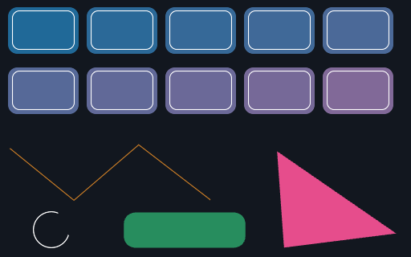

# UI MSAA evaluation — 2026-10-27

Keep the desktop UI default at **4x MSAA**. Analytic **1x** is available per window
for applications that control all their geometry. Raw custom triangles still
need multisampling at their boundaries. Ordinary Apple-GPU window frames now
retain 4x coverage using transient tile storage. This setting does not change Diffuse's
3D scene renderer or its temporal antialiasing.

## Measurement

Apple M1 (MacBookAir10,1), macOS 27.0.1, Metal; debug host build, precompiled UI
shaders, GPU validation disabled. The logical scene is 512 × 320, with 1x and 2x
physical scale. Each configuration warms up four frames, then records thirty
frames with a GPU idle between submissions. GPU time is the completed Metal
command buffer's `gpuEndTime - gpuStartTime`, excluding CPU encoding and queue
wait. CPU numbers include encoding/submission, without the subsequent idle wait.
The GPU figure covers this small UI scene and is not a whole-editor FPS estimate.

The persistent baseline preserves and resolves its samples, as the previous
window path did. The transient path resolves once and discards the multisample
attachment. Both use identical 4x geometry, pipelines and physical dimensions.

| Scale | UI samples/storage | GPU median (ms) | CPU median (ms) | MSAA logical (MiB) | Metal allocated (MiB) | Triangle RGB MAE |
| --- | --- | ---: | ---: | ---: | ---: | ---: |
| 1x | analytic 1 | 0.0877 | 0.0773 | 0.000 | 0.000 | 0.5344 |
| 1x | persistent 4 baseline | 0.1461 | 0.0801 | 2.500 | 2.531 | 0.1374 |
| 1x | transient 4 | 0.1182 | 0.0777 | 2.500 | 0.000 | 0.1374 |
| 2x | analytic 1 | 0.1858 | 0.0887 | 0.000 | 0.000 | 0.2640 |
| 2x | persistent 4 baseline | 0.4270 | 0.0906 | 10.000 | 10.125 | 0.0700 |
| 2x | transient 4 | 0.2898 | 0.0895 | 10.000 | 0.000 | 0.0700 |

The reference renders at four times each output dimension and downsamples 4 × 4
samples per output pixel. MAE is the mean absolute 8-bit RGB channel difference
(0–255) in the triangle region. Its unsnapped geometry is identical in both paths.
The full-scene/edge errors in the raw report also include differences from
coordinate snapping and curve tessellation at the reference resolution; they
are not an isolated AA accuracy score.

The transient 4x path reduced GPU duration by about **19% / 32%** relative to
the persistent 4x baseline in this run, while its resolved pixels were **byte for
byte identical** at both scales. MSAA 4x reduced triangle-region error by about
**74%** compared with analytic 1x. Raw custom triangles still have hard boundaries
at 1x, so dropping the global sample count remains a visual tradeoff.

## Keeping 4x while reducing memory

A separate Apple M1 allocation probe used a 3840 × 2160, 4x BGRA8 sRGB attachment:

| Storage | Logical sample capacity | Metal resource allocation |
| --- | ---: | ---: |
| persistent private | 126.6 MiB | **129.5 MiB** |
| memoryless | 126.6 MiB | **0 MiB persistent backing** |

The extra allocation above the logical size comes from the backend's layout and
alignment. Memoryless samples live in GPU tile storage; the final single-sample
image and drawable pools still need memory. The probe's resolved triangle images
were identical. [Raw allocation result](evaluations/msaa-metal-m1-2026-10-27/allocation-4k.json).
Apple documents [memoryless attachment storage](https://developer.apple.com/documentation/metal/choosing-a-resource-storage-mode-for-apple-gpus).

Cove selects this path for ordinary single-pass windows on supported Apple GPUs.
Frosted backdrops and reveals reload earlier samples across render passes, so
those frames retain private attachments and switch back when the frame simplifies.
The sample count, resolution, geometry and shaders stay unchanged. Other backends
fall back to their existing device-local allocation until they implement transient
backing; they must not report unknown allocation as zero.

Window snapshots and DevTools distinguish logical target capacity from
`msaaAllocatedBytes` and `msaaMemoryless`. Allocation describes the current texture,
not process RSS, driver pools, 3D scene textures or replaced textures that remain
in flight until GPU completion. Hiding a window releases its targets as before.

## Captures

Analytic 1x:


Persistent MSAA 4x baseline:


Transient MSAA 4x (same pixels):



[Supersampled reference](evaluations/msaa-metal-m1-2026-10-27/reference-1x.png),
[raw measurements](evaluations/msaa-metal-m1-2026-10-27/report.json).

## Reproduce

```sh
COVE_MSAA_EVALUATION=1 ./cove test . --filter MSAAEvaluationTests --no-parallel --testing-library swift-testing
```

`COVE_MSAA_OUTPUT` overrides the output directory; the default is
`/tmp/cove-msaa-evaluation`. This measurement is opt-in and is skipped by ordinary
CI runs. The transient path also has focused pixel-parity, invalid-use, frosted-frame
fallback, reveal and suspend/resume coverage. Next steps before lowering the
global default are analytic boundaries
for custom meshes, text/image/backdrop coverage, and comparable Vulkan/DX12
captures and timings. Those backends have not been assessed by this Metal run.
